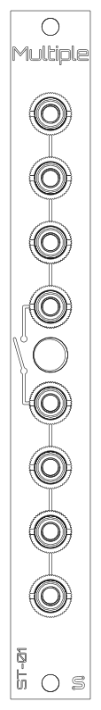

<picture>
  <source media="(prefers-color-scheme: dark)" srcset="docs/images/logo-light.png">
  
</picture>

# ST-01 Multiple

A 3HP Eurorack passive multiple from **Schenktronics**: two banks of four jacks, and a latching button that links them into one eight-jack multiple. Push the button in time with the music and it doubles as a performance mute. No power needed.



## Features

- 3HP, 15 mm deep behind the panel (skiff-friendly), no power needed
- Two 4-jack banks, or one 8-jack multiple when linked
- Latching link button between the banks: in = linked, out = split
- All through-hole, 30 solder joints: a good first kit

## Documentation

| Document | For | PDF |
|----------|-----|-----|
| [User Manual](docs/manual.md) | Using the module | [PDF](docs/pdf/ST-01_Multiple_User_Manual.pdf) |
| [Assembly Guide](docs/assembly-guide.md) | Building the kit | [PDF](docs/pdf/ST-01_Multiple_Assembly_Guide.pdf) |
| [Bill of Materials](docs/BOM.md) ([CSV](docs/BOM.csv)) | Parts and sourcing | |

## Repository layout

```
hardware/
  ST01_Multiple.step          3D model of the assembled module
  multiple/                   Main PCB (KiCad 5.1 schematic, KiCad 10 PCB)
    Multiple.sch                 Schematic
    Multiple.kicad_pcb           PCB layout
    Multiple.step                3D model
    BOM.ods                      Original BOM spreadsheet
  panel/                      Faceplate (KiCad 10, made as an aluminium PCB)
    MultipleFaceplate.kicad_pcb  Faceplate layout
    MultipleFaceplate.step       3D model
docs/                         Manual, assembly guide, BOM, images
  drawings/                     Scripts that generate the drawings
  pdf/                          PDF versions and their build settings
```

## Fabrication

| Board | Size | Layers | Thickness | Notes |
|-------|------|--------|-----------|-------|
| Main PCB | 15 x 100 mm | 2 | 1.6 mm | Standard green is fine |
| Faceplate | 15 x 128.5 mm | 1 | 1.6 mm | Aluminium PCB, white solder mask, black silkscreen. Only the front copper layer is used, so FR4 works too. |

## License

This hardware design and its documentation are licensed under [CC BY-NC-SA 4.0](https://creativecommons.org/licenses/by-nc-sa/4.0/). See [LICENSE](LICENSE).

The Schenktronics name and logo are trademarks of Nathan Schenk and are not covered by the CC BY-NC-SA 4.0 license.

## Links

- Shop: <https://schenktronics.com/product/st-01/>
- Docs page: <https://schenktronics.com/docs/st-01/>
- Tindie: <https://www.tindie.com/products/schenktronics/passive-multiple/>
- ModularGrid: <https://modulargrid.net/e/schenktronics-multiple>
- Build video: <https://www.youtube.com/watch?v=nGc3uMlrRig>
- Website: <https://schenktronics.com>
