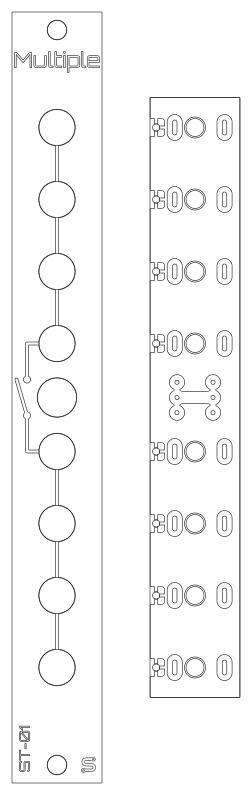
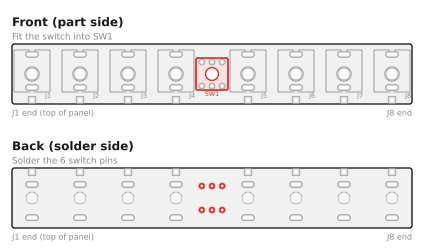
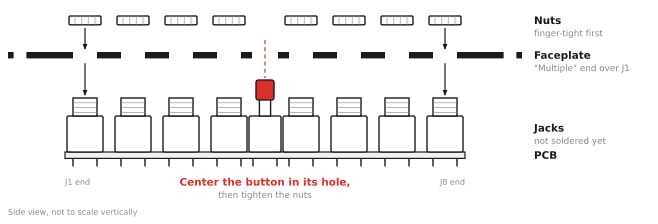
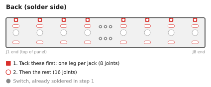
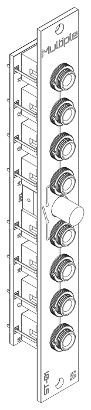

# ST-01 Multiple: Assembly Guide

This kit takes about 20-30 minutes and 30 solder joints. There are no polarized parts, and nothing to get backwards except which side of the board the parts go on, so it makes a good first Eurorack build.

## What you need

### Kit contents

Check your kit against this list before you start (full details in the [BOM](BOM.md)):

- [ ] 1 x main PCB
- [ ] 1 x faceplate
- [ ] 8 x 3.5 mm jacks with nuts
- [ ] 1 x latching pushbutton switch
- [ ] 1 x button cap

### Tools

- Soldering iron (about 330-360 °C for leaded solder, a little hotter for lead-free)
- Solder: 0.8 mm, flux-core
- Safety glasses, since solder can spit
- Multimeter with a continuity (beep) mode
- Small pliers (optional, for squaring up the jacks)
- Nut driver or wrench for the jack nuts (optional, but less likely to scratch the panel than pliers)
- 3D-printed solder jig (optional, see [Building with the solder jig](#building-with-the-solder-jig-optional))

## Before you start

- The jacks and switch go on the **front** of the PCB, the side with the part outlines (J1-J8, SW1). The back is printed "ST-01 v1.1 / Passive Multiple" and "schenktronics.com", and that's the side you solder on.
- The switch gets soldered first. **Don't solder the jacks until the faceplate is on.** The faceplate holds the jacks in line, and it's how you center the button in its hole. If you have a 3D printer, the [solder jig](#building-with-the-solder-jig-optional) does that job instead, and lets you solder everything in one step.

### First time soldering?

You only need the basics for this kit:

- Touch the iron to the pad and the pin at the same time, then feed solder into the joint, not onto the iron tip. A second or two is usually enough.
- A good joint is shiny and shaped like a small cone around the pin. A dull, lumpy blob usually means the pad didn't get hot enough; reheat it, use some flux, and add a touch more solder if necessary.
- Keep the tip clean and lightly tinned. Wipe it on a damp sponge or brass wool between joints.
- Remember that solder flows toward the heat.
- Leaded solder (63/37 or 60/40 tin/lead) is easier to learn with than lead-free: it melts at a lower temperature and flows more easily. Lead-free works fine too, with a slightly hotter iron. Use whichever you prefer.
- If you use leaded solder, wash your hands when you're done, and don't eat, drink, or smoke while you're soldering. Wipe down your work surface afterward, and keep solder away from kids.
- Solder somewhere with some airflow, and keep your face to the side of the fumes, not right above them. The fumes primarily come from the flux, not the metals in the solder, but they can irritate your lungs.

## Building with the solder jig (optional)

The jig is a 3D-printable block that holds the eight jacks and the button square and centered while you solder them, in place of the faceplate. Download [ST-01_Solder_Jig.stl](../hardware/jig/ST-01_Solder_Jig.stl) and print it in PLA, pockets facing up, with no supports. It fits the jacks supplied in the kit; panel-mount style jacks won't fit it.

1. Take the nuts off the jacks, and leave the cap off the button.
2. Push the button and all eight jacks into the front of the PCB, as in Steps 1 and 3. Don't solder anything yet.
3. Lower the jig over the parts, pockets down, with the end engraved "J1" over J1. Wiggle it until every jack and the button seat into their pockets.
4. Turn the whole stack over so the jig sits on the bench and the back of the PCB faces up.
5. Solder all 30 joints. The board sits 4 mm above the jig, so the plastic stays clear of the iron.
6. Lift the board out of the jig.

Then fit the button cap (Step 2), fit the faceplate and nuts (Step 3), and snug the nuts down. Everything is already soldered and centered, so skip Step 4 and go on to test (Step 5).

## Step 1: Solder the switch

1. Push the switch's six pins into the SW1 footprint from the front of the PCB. It fits either way round: the footprint is wired symmetrically.
2. Hold it flat against the board and square to it, then solder one pin from the back.
3. Check that the switch is still flat and straight. If it isn't, reheat that pin and straighten it.
4. Solder the other five pins. Don't linger on them, so the plastic body doesn't overheat.

## Step 2: Fit the button cap

Press the cap onto the switch plunger, then push the button a few times to check that it latches in and pops back out.

## Step 3: Fit the jacks and faceplate

1. Take the nuts off the jacks and set them aside.
2. Push all eight jacks into J1-J8 from the front of the PCB. Make sure each one sits flat with all three legs through their holes. Don't solder them yet.
3. Lower the faceplate over the jacks. The "Multiple" label goes at the top, next to J1, and the button goes through the bigger hole between the two banks.
4. Rubber bands or small spring clips can be helpful to hold the faceplate and the board together while you work.
5. Put the nuts back on and hand-tighten them for now.
6. Use a small pair of pliers to rotate the jack bodies as necessary to align them squarely with each other. This step is optional, but a nice touch.
7. Shift the PCB until the button is **centered in its hole** and moves in and out without rubbing. The jack legs have a little play in their holes, which gives you room to adjust.

## Step 4: Solder the jacks

Turn the whole thing over and solder from the back of the PCB.

1. On each jack, solder only the square pad. Then check again that the button is centered and moves freely. If it doesn't, reheat those eight joints and nudge the board.
2. Solder the other two pads on each jack (24 jack joints in all).
3. Snug the nuts down. Don't overtighten: it can strip the jack threads or damage the panel.

> **Using panel-mount style jacks?** The oval pads also take jacks like the CUI MJ-3507. Their tip and switch pins go into the board, but the sleeve is a solder lug on the jack, not a pin. Tack the tip pin instead of the square pad, then solder a short wire from each jack's sleeve lug to its square pad. Without the wire, the jack has no ground.

Look over every joint before moving on. Each should be shiny and cone-shaped, with no solder bridging neighboring pads.

## Step 5: Test

Set your multimeter to continuity mode. No power is needed. The tip contact is the one that touches the tip of a plugged-in cable; the easiest way to test is to plug in two patch cables and probe their plugs.

| Test | Expected result |
|------|-----------------|
| Sleeve of any jack <-> sleeve of every other jack | Beep |
| Tip <-> tip, within Bank A (top four) | Beep |
| Tip <-> tip, within Bank B (bottom four) | Beep |
| Tip of Bank A <-> tip of Bank B, button **in** | Beep (linked) |
| Tip of Bank A <-> tip of Bank B, button **out** | No beep (split) |
| Tip <-> sleeve, any jack, either button position | **No beep.** A beep means a short: look for a solder bridge. |

## Step 6: Install

Mount the module in your case with two M3 screws. How to use it is in the [User Manual](manual.md).

## Troubleshooting

| Symptom | Likely cause |
|---------|--------------|
| One jack is dead | A cold or missing joint on that jack. Reflow all three of its legs. |
| The banks never link, or never split | A bad joint on the switch, or the switch isn't fully seated. Reflow the six switch pins. |
| A signal is shorted to ground | A solder bridge between a tip pad and a sleeve pad. |
| The button rubs or sticks | It isn't centered in its hole. Loosen the nuts, reheat the jack joints, and shift the board until it's centered. |
