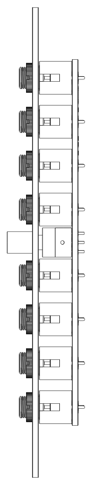
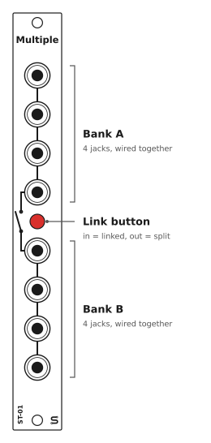
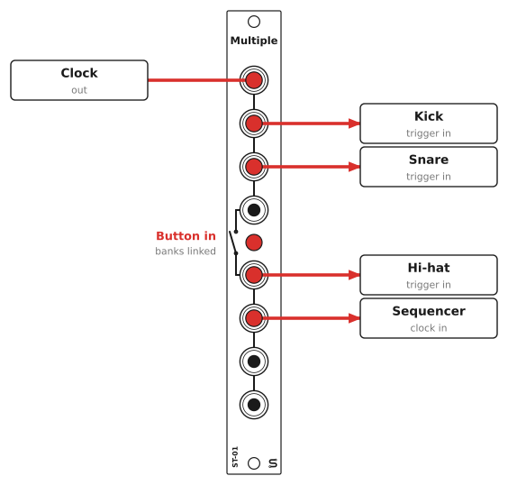
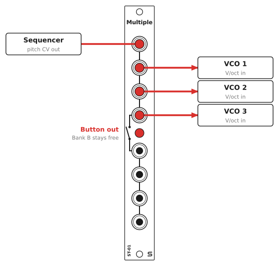
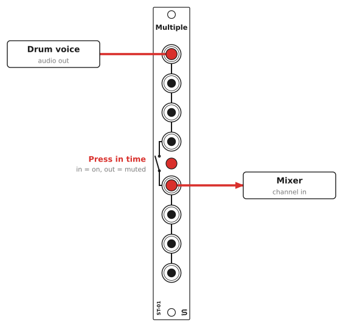
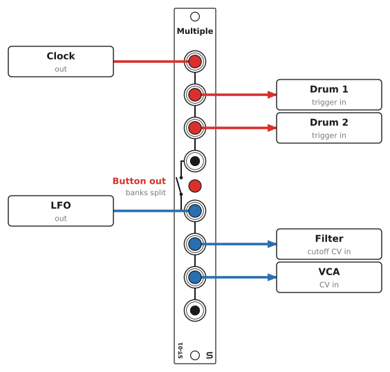

# ST-01 Multiple: User Manual

## Overview

The Multiple is a 3HP passive mult with eight jacks in two banks of four. Every jack in a bank is wired to the others, so a signal patched into one comes out of the other three. The red button links the banks into a single eight-jack multiple.

There's nothing on the board but jacks and a switch, so it doesn't need power.

## Specifications

| | |
|---|---|
| Format | Eurorack, 3HP |
| Panel | 15 x 128.5 mm |
| Depth | 15 mm behind the panel (skiff-friendly) |
| Power | None |
| Jacks | 8 x 3.5 mm mono (TS) |
| Switch | Latching push-on/push-off button (in = linked), rated 0.1 A / 30 VDC |

## Panel layout

The lines on the panel show what's connected to what: jacks joined by a line are wired together, and the switch symbol between the banks is the link button.

## Using the module

### The link button

The button latches: push it once and it stays in, push it again and it pops back out.

- **Out (split):** two separate multiples, each 1 in and 3 out. Patch a source into any jack in a bank and take copies from the other three.
- **In (linked):** all eight jacks are connected, giving you 1 in and 7 out.

### Using the button as a performance switch

The button also works as a live mute. Patch a signal into Bank A and take it out of Bank B, and the button turns it on and off. Hit it in time with the music to drop a part in and out, mute a modulation source, or cut a clock or gate stream.

You can still use the rest of the module as a multiple while you do this. The other jacks in Bank A always carry the signal; the jacks in Bank B only carry it while the button is in.

With the button out, the Bank B jacks aren't connected to anything, so whatever's patched from them gets no signal. The switch cuts hard, so on audio you may hear a click.

### Signals in any direction

None of the jacks are inputs or outputs. They're just wired together, so any jack works either way. That means you can also use a bank as a coupler, to join two patch cables when one isn't long enough.

## Patch examples

Each drawing shows the module sending the signal on the left and the modules receiving it on the right. Any jack in a bank will work, the drawings just use the first free ones.

### One clock to four modules

Patch a clock into Bank A and push the button in. The other seven jacks now all carry the clock, enough to keep a handful of drums, sequencers, and clock dividers in time. If three copies are enough, leave the button out so you can use the other bank for something else.

### Pitch to three oscillators

Send one sequencer's pitch CV to three VCOs so they play the same notes. Detune them slightly for a thick unison, or set them an octave or a fifth apart. A passive multiple can pull pitch CV slightly out of tune (see [Good practice](#good-practice)), so check your tuning once everything's patched.

### Performance mute

Patch a signal into Bank A and take it out of Bank B, as in [Using the button as a performance switch](#using-the-button-as-a-performance-switch), then play the button to drop the part in and out of the mix. It's good for drums, gates, and modulation.

### Two separate multiples

With the button out, you have two independent mults. Here Bank A sends a clock to two drum voices, and Bank B sends one LFO to both a filter's cutoff and a VCA, so they move together. Don't push the button in on this patch: it would tie the clock and LFO outputs together.

## Good practice

- **One output per bank.** Two module outputs patched into the same bank (or into both banks with the button in) are shorted together. Most Eurorack outputs have protection resistors and will survive it, but what comes out is a mess of the two signals. It's the most common mistake people make with a multiple.
- **Pitch CV (V/oct).** A passive mult has no buffer. Most inputs are high impedance, so the load is small, but spreading one pitch CV across several oscillators can drop the voltage slightly and leave them a little out of tune. If tuning is critical, use a buffered multiple.
- **Audio and gates** go through a passive multiple just fine.
- **Grounds.** The sleeves of all eight jacks are always wired together, regardless of whether the button is pressed or not.

## Installation

1. Turn your case off. This module doesn't need power, but you shouldn't be working in a powered case anyway.
2. Put the module in any free 3HP space. There's no ribbon cable to connect.
3. Fix it in place with two M3 rack screws. Don't overtighten them.

## Circuit

Each jack's tip is wired to the other tips in its bank, and all the sleeves are wired together. The switch's two poles are wired in parallel between the Bank A tips and the Bank B tips. The schematic is in [hardware/multiple/Multiple.sch](../hardware/multiple/Multiple.sch) (KiCad 5).
